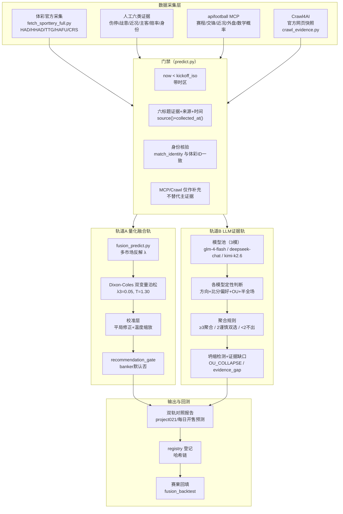

# 模型运行图

> 双轨模型运行架构与数据流。事实源见 [[30_数据/APIfootball数据契约]] 与 [[AGENTS.md|AGENTS.md]]（项目总览已并入此文档）。

## 总览：数据流 → 双轨 → 对照



## 模型分层（轨道A 量化层）

```text
p_market ← 体彩 HAD（市场锚，去水 power 法）
   ↓
λ ← 多市场反解（HAD/HHAD/TTG/HAFU 联合拟合）
   ↓
比分矩阵 ← 双变量泊松（ρ=-0.08）
   ↓
校准层 ← 平局修正 k=1.14 + 温度缩放 T=0.96（1348场）
   ↓
输出：final_1x2 / top_scores / O-U2.5 / BTTS / 让球
   ↓
门禁：market_only 时市场依赖=100%，不宣称独立 edge
```

## 模型分层（轨道B LLM证据层）

```text
六类证据（每类≥2独立域名，每条 source()+collected_at()）
   ↓ 门禁通过
glm-4-flash ─┐
deepseek-chat ├→ 方向投票聚合（反坍缩提示词）
kimi-k2.6   ─┘        ↓
          客胜2.975票 / 平局1.700票（例：08-11 凯拉特vs列夫斯基）
               ↓
输出：方向（H/D/A 可双选）+ 比分偏好 + OU2.5 + 半全场
禁止伪概率；证据缺口→降级双选；全票一致→标记坍缩
```

## 关键运行约束

| 环节 | 规则 |
|---|---|
| 赛前门禁 | `now >= kickoff` 直接拒绝；时间必须带时区 |
| 模型法定人数 | ≥3 正常聚合；2 谨慎双选；<2 不输出方向 |
| 模型池 | ⚠️ **不要在本表信任具体清单，实测漂移过**：`football_predictor.py::DEFAULT_MODELS` 代码里仍含 `qwen/qwen3.8-max`（文档曾说 2026-08-12 已移除，代码未同步）；08-15 当天实跑用的是 `glm-4-flash + deepseek-chat + doubao-seed-evolving`（`--models` 覆盖默认值，非 kimi-k2.6）。每次要确认当前池，去读代码或当次报告头部的"模型池"行，不要信任任何文档里写死的清单。 |
| 量化轨 | cohort 主键 2026-08-15 起为 `model_version`+`probability_signature`（非字节哈希，见 [[40_模型/模型版本管理_打破current死锁]]）；未达 100 场同 `model_version` OOS 校准前，保持 `MARKET_BASELINE` |
| 双轨关系 | 并列对照，不把共享证据下的模型共识伪装成独立验证；LLM 轨 `strength`（投票比例）不是概率，禁止代入 EV 公式（见 AGENTS.md「LLM 轨报告纪律」） |
| 回测 | registry 哈希链登记；~~8 条历史分裂~~已于 2026-08-12 合并、2026-08-14 全量复验零异常（`verify_registry_chain.py`），仍禁止手动 append，改动必须重算整条链 |

## 相关笔记

- [[AGENTS.md|AGENTS.md]] —— 系统全貌与路由入口（项目总览已并入此文档）
- [[40_模型/模型分层与在线适应]] —— 分层细节与门禁
- [[30_数据/APIfootball数据契约]] —— 数据契约与分裂
- [[50_评测/样本积累与评测规则]] —— 评测口径
